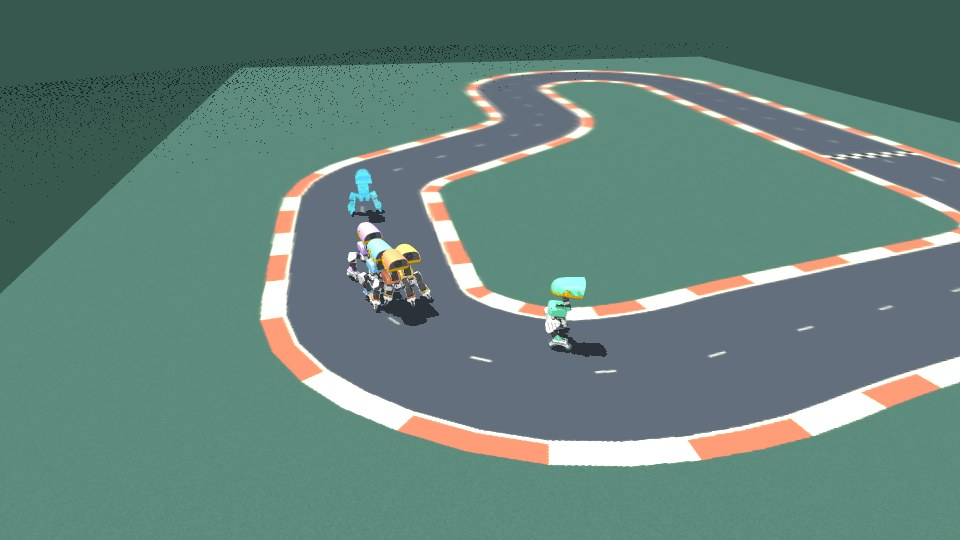

# Microduck Skate Circuit

I wanted to see if my Microduck could find a faster way around a racing circuit on skates. I put it on the original AWS DeepRacer re:Invent 2018 course and gave it a centreline ghost to chase. The ghost and the challenger both use Pollen’s roller policy to move their legs. The challenger learns where to skate and how fast to take each part of the lap.

**[Watch the training laps in 3D](https://jackdanhollister.github.io/microduck-skate-circuit/?view=training)**. Pick a search, generation and start seed, then press **Play**. I like watching ten candidates through the same bend to see whose skates step out. The **Drivers** menu lets you show all 30 from that start. Copy the URL to share the group you are watching.

Duck 28 set the quickest lap I saw during training, 25.04 s. It came in generation nine of the cornering search. Four of the other nine ducks in its group of ten went off track on that start. [Follow Duck 28 through the bend](https://jackdanhollister.github.io/microduck-skate-circuit/?view=training&strategy=corner&generation=9&seed=182&heat=3) · [Ten-second clip](https://jackdanhollister.github.io/microduck-skate-circuit/replays/duck-28-corner.mp4)

I also kept a five-duck race with the two earlier drivers and the three that came out of the parallel searches. You can watch their legs move in **3D**, switch to **Map** to compare their lines, or choose **Film** for the moving trackside camera. [Race the five saved drivers](https://jackdanhollister.github.io/microduck-skate-circuit/?view=all) · [Play the trackside film](https://jackdanhollister.github.io/microduck-skate-circuit/replays/ghost-race.mp4)

[](https://jackdanhollister.github.io/microduck-skate-circuit/?view=all)

## Where the training ghosts came from

The original searches saved their random seeds and the selected driver after each generation. To get the full body motion, I repeated the searches in the same MuJoCo environment and recorded every candidate in the main training populations. All 30 generation checkpoints and their selection scores matched the originals.

There are **3,000 candidate laps** across ten generations of Pace, Corner and Stability. Each group puts 30 candidates on the same start. Pace and Corner each tried three starts per generation and Stability tried four. Of those laps, 2,524 finished, 317 ended in a fall and 159 went off track. The viewer loads the selected group on demand. Each ghost uses the duck’s recorded body position, orientation and 14 joint angles. [Browse the 100 groups](https://jackdanhollister.github.io/microduck-skate-circuit/?view=training) · [Recording code](record_training.py)

## Which duck wins?

On the five-driver replay (start seed 1), **Stability** crosses first in **25.76 s**. Cornering takes 27.19 s and Pace takes 27.30 s. The field includes my first two drivers as well, so I can see where each generation gained or lost ground. [Race all five](https://jackdanhollister.github.io/microduck-skate-circuit/?view=all)

I picked **Cornering** as my featured driver. I ran Pace, Cornering and Stability as three separate ten-generation searches from the same parent, with different random seeds. Cornering and Pace finished all 48 selection starts. Stability finished 46. Cornering had the quicker typical lap of the two that finished them all. I froze its checkpoint before running a separate test. [Selection results](replays/parallel-selection.json)

| Driver on the same 64 new starts | Clean finishes | Median clean lap |
|---|---:|---:|
| Centreline ghost | 64/64 | 29.63 s |
| Round two (parent) | 61/64 | 27.73 s |
| Cornering | 64/64 | 26.67 s |

Cornering beat its parent on every one of the 61 starts where both finished. The median gain on those paired laps was 1.02 s. This measures the drivers on one simulated course. [All 64 paired results](replays/parallel-evaluation.json)

My earlier round-two driver finished 64/64 on its own test set, compared with 57/64 for my first racer. The two tests used different starting seeds. Every archived driver has its own replay, checkpoint and standard 16-start evaluation in the [run tree](lineage/index.md). [Earlier comparison](replays/championship-evaluation.json)

## Race from a fork

Choose **Fork** on GitHub, then **Actions → Train a racer** in your fork. Pick a parent driver and a new run ID. The job gives you a replay to watch and can save the child on a branch in your fork. [Browse the run tree](lineage/index.md) · [How to record and share a run](docs/runs.md)

## Try your own duck

The [race viewer](https://jackdanhollister.github.io/microduck-skate-circuit/) opens straight away in a browser. To run the simulation or train a driver, I use a Linux x86-64 machine with Git, Python 3.12 and a CPU. You can run it on a laptop. The first run needs internet access to download Pollen's roller policy, which is public and cached for later runs.

### 1. Get the project

If you plan to share your own runs, [fork this repo](https://github.com/JackDanHollister/microduck-skate-circuit/fork) first. On your fork, use **Code → HTTPS** and use that URL in the clone command below. To try my version as it is:

```bash
git clone https://github.com/JackDanHollister/microduck-skate-circuit.git
cd microduck-skate-circuit
```

### 2. Set up Python

From that folder, create and activate a virtual environment, then install the simulator.

```bash
python3.12 -m venv .venv
source .venv/bin/activate
python -m pip install -r requirements.txt
```

If `python3.12` is missing or your system Python cannot create a virtual environment, [install uv](https://docs.astral.sh/uv/getting-started/installation/) and run `uv venv --python 3.12 --seed .venv` in place of the first line. It can download Python 3.12 and includes pip. When you return in a new terminal, change into the repo and run `source .venv/bin/activate` again.

### 3. Run a lap and watch it

```bash
python race.py replay --seed 1 --output runs/my-lap.json
```

The terminal prints a time and finish status for both the **baseline** (the ghost) and the **challenger** (the saved driver). Choose **Open replays** in [the viewer](https://jackdanhollister.github.io/microduck-skate-circuit/) and select `runs/my-lap.json` to watch the recorded duck in 3D or follow its line on the map. The file opens locally in your browser. If a driver falls, the replay shows where the attempt ended.

You can also serve the viewer from your clone. Run `python -m http.server 8000 --bind 127.0.0.1` in the repo root, open [localhost:8000](http://localhost:8000), then use **Open replays**. Press Ctrl+C in the terminal to stop the server.

### 4. Train a driver

Pick a parent in the [run tree](lineage/index.md). Here's how to start from my first published driver, write your results under `runs/` and compare the new driver with the centreline ghost on fresh starts:

```bash
python race.py train --start-from lineage/jackdh-first-lap/driver.json \
  --workers 4 --generations 6 --policy runs/my-driver.json --output runs/my-race.json
python race.py evaluate --policy runs/my-driver.json --workers 4 --report runs/my-results.json
```

`my-driver.json` contains the settings you trained, `my-race.json` opens in the viewer, and `my-results.json` records the evaluation. Use `--workers 1` on a small machine or if you want to leave cores free. To keep the parent and child together on GitHub, follow [Share a run from your fork](docs/runs.md).

### 5. Run several searches together

I split one CPU budget across three trainers. They all start from the same driver. The **pace** trainer tries bigger changes in speed. The **cornering** trainer varies its line and steering more. The **stability** trainer makes smaller changes and tests each candidate on one extra start. Each gets its own random seed. On a machine with six spare cores:

```bash
python league.py train --start-from lineage/jackdh-round-two/driver.json --workers 6 --generations 10 --output runs/league
```

Six workers means two per trainer. Use a fresh output folder for each batch. Each trainer saves its driver, replay and log under `runs/league/pace/`, `corner/` or `stability/`. The league compares all three with their parent on the same 48 selection starts. It saves the winner in `runs/league/winner.json` and the comparison in `runs/league/selection.json`. The parent can win. Open the three `race.json` files in the viewer to compare the laps.

To check whether that winner improves on the parent, use a fresh range of starts shared by both drivers and the centreline ghost:

```bash
python compare_drivers.py --parent runs/league/parent.json --challenger runs/league/winner.json \
  --first-seed 12000 --starts 64 --workers 6 --output runs/league/final-test.json
```

To run this on GitHub's machines, go to **Actions → Train a racer** in your fork and set **Independent searches** to **three**. Each search produces its own child run. [Run it on GitHub](docs/runs.md#run-it-on-github)

To keep all three replays in your fork, archive the league under the ID of the parent you used. They will appear side by side in the tree and race together on the map when the fork's Pages site updates. [Save all three ghosts](docs/runs.md#save-all-three-ghosts-from-a-local-league)

## How the lap works

My first driver split the track into six sectors, and round two used 12. A driver chooses a forward speed and an offset from the centreline at each one. It blends the settings between sectors, looks ahead to a point on the chosen line and asks Pollen's roller policy for a forward speed and turn rate. The driver reads the duck's position and heading from the simulator.

I used cross-entropy search over complete episodes to train those settings, the lookahead distance and the turn response. Round two started from the first driver's settings and trained for 26 generations. A clean finish earns a time-based reward. A failed lap earns partial credit for progress. Eight gates must be crossed in order, and the simulation checks wheel-centre boundaries and falls. The ghosts come from separate simulation runs with the same start seed and play against the same clock. [Simulation and training code](race.py)

## Rebuild the training archive

The published browser replay already includes the recorded poses. To reconstruct the ten original generations yourself, run this in the Python 3.12 environment above. The workers are a total budget shared across the three searches. For a shorter first try, set `--generations 1` and use a fresh output folder. The full archive is about 41 MB.

```bash
python record_training.py --workers 6 --generations 10 --output runs/rebuilt-training
```

It writes the selected generation groups, one centreline reference for each start seed, and an index with finish times, failures and file checksums. [Published archive index](training-replays/index.json)

## Make a trackside film

The browser draws the 3D poses directly from replay data. For a separate MP4 on a machine with an EGL graphics driver, install the rendering extras. The first command below films your own race, the second films the full saved field from the same circuit and start seed.

```bash
python -m pip install -r requirements-render.txt
MUJOCO_GL=egl python render_race.py runs/my-race.json runs/my-race.mp4
MUJOCO_GL=egl python render_race.py lineage/index.json runs/all-ghosts.mp4 --field
```

## Credits

This is a community Microduck experiment. The physics come from [Pollen’s Microduck Arena](https://github.com/pollen-robotics/microduck-arena/releases/tag/v0.7.0). The leg movements come from [Pollen’s roller policy](https://huggingface.co/pollen-robotics/microduck-policies/tree/1b56c396825c052a4e26e95cf2b8d8298af9e9b4). I converted the AWS route coordinates to JSON and used those points for the timing gates, track edges and replay. [Track source and notices](data/README.md)

The browser robot uses Pollen Robotics’ Microduck meshes, adapted for animated replay under CC BY-NC-SA 4.0, and Pollen’s Apache 2.0 joint description. Three.js draws the track and ghosts in the browser. [Mesh attribution and licences](assets/duck-attribution.md) · [Three.js licence](vendor/three/LICENSE)
