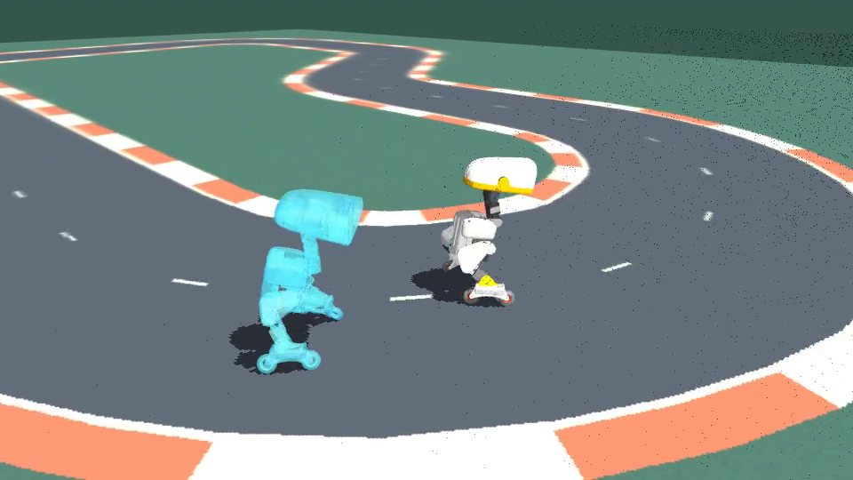

# Microduck Skate Circuit

I wanted to see if my Microduck could find a faster way around a racing circuit on skates. I put it on the original AWS DeepRacer re:Invent 2018 course and gave it a centreline ghost to chase. The ghost and the challenger both use Pollen’s roller policy to move their legs. The challenger learns where to skate and how fast to take each part of the lap.

**[Watch the race](https://jackdanhollister.github.io/microduck-skate-circuit/)**. Press **Play** on the overhead map to see the speed trail, or switch to **Trackside** to watch the white duck race the blue ghost. The viewer runs in a browser on a phone or laptop.

[](https://jackdanhollister.github.io/microduck-skate-circuit/)

## Which duck wins?

I ran the centreline ghost, my first racer and its new driver on the same 64 fresh simulated starts. The new driver finished every lap. I kept the first driver in the run tree so anyone can race it or try a different branch. [Compare the runs](lineage/index.md)

| Driver | Clean finishes | Median clean lap |
| --- | ---: | ---: |
| Centreline ghost | 64 / 64 | 29.60 s |
| First racer | 57 / 64 | 27.96 s |
| Round two | 64 / 64 | 27.63 s |

Round two beat its parent on 41 of the 57 starts where both finished. On the **featured start**, round two took **27.84 s**, the original driver took **27.54 s** and the centreline ghost took **29.83 s**. I chose round two for its clean finishes and typical pace. [All 64 results](replays/championship-evaluation.json) · [Watch the original run](https://jackdanhollister.github.io/microduck-skate-circuit/?run=jackdh-first-lap)

## Race from a fork

Choose **Fork** on GitHub, then **Actions → Train a racer** in your fork. Pick a parent driver and a new run ID. The job gives you a replay to watch and can save the child on a branch in your fork. [Browse the run tree](lineage/index.md) · [How to record and share a run](docs/runs.md)

## Try your own duck

The [race viewer](https://jackdanhollister.github.io/microduck-skate-circuit/) opens straight away in a browser. To run the simulation or train a driver, I use a Linux x86-64 machine with Git, Python 3.12 and a CPU. You can run it on a laptop. The first run needs internet access to download Pollen's roller policy; the download is public and is cached for later runs.

### 1. Get the project

If you plan to share your own runs, [fork this repo](https://github.com/JackDanHollister/microduck-skate-circuit/fork) first. On your fork, use **Code → HTTPS** and use that URL in the clone command below. To try my version as it is:

```bash
git clone https://github.com/JackDanHollister/microduck-skate-circuit.git
cd microduck-skate-circuit
```

### 2. Set up Python

From that folder, create and activate a virtual environment, then install the simulator.

```bash
python3.12 -m venv .venv
source .venv/bin/activate
python -m pip install -r requirements.txt
```

If `python3.12` is missing or your system Python cannot create a virtual environment, [install uv](https://docs.astral.sh/uv/getting-started/installation/) and run `uv venv --python 3.12 --seed .venv` in place of the first line. It can download Python 3.12 and includes pip. When you return in a new terminal, change into the repo and run `source .venv/bin/activate` again.

### 3. Run a lap and watch it

```bash
python race.py replay --seed 1 --output runs/my-lap.json
```

The terminal prints a time and finish status for both the **baseline** (the ghost) and the **challenger** (the saved driver). Choose **Open replay** in [the viewer](https://jackdanhollister.github.io/microduck-skate-circuit/) and select `runs/my-lap.json` to watch on the overhead map. The file opens locally in your browser. If a driver falls, the replay shows where the attempt ended.

You can also serve the viewer from your clone. Run `python -m http.server 8000 --bind 127.0.0.1` in the repo root, open [localhost:8000](http://localhost:8000), then use **Open replay**. Press Ctrl+C in the terminal to stop the server.

### 4. Train a driver

Pick a parent in the [run tree](lineage/index.md). Here's how to start from my first published driver, write your results under `runs/` and compare the new driver with the centreline ghost on fresh starts:

```bash
python race.py train --start-from lineage/jackdh-first-lap/driver.json \
  --workers 4 --generations 6 --policy runs/my-driver.json --output runs/my-race.json
python race.py evaluate --policy runs/my-driver.json --workers 4 --report runs/my-results.json
```

`my-driver.json` contains the settings you trained, `my-race.json` opens in the viewer, and `my-results.json` records the evaluation. Use `--workers 1` on a small machine or if you want to leave cores free. To keep the parent and child together on GitHub, follow [Share a run from your fork](docs/runs.md).

### 5. Run several searches together

I split one CPU budget across three trainers. They all start from the same driver. They use different search seeds to explore **pace**, **cornering** and **stability**. On a machine with six spare cores:

```bash
python league.py train --start-from driver.json --workers 6 --generations 8 --output runs/league
```

Six workers means two per trainer. Use a fresh output folder for each batch. Each trainer saves its driver, replay and log under `runs/league/pace/`, `corner/` or `stability/`. The league compares all three with their parent on the same 48 selection starts. It saves the winner in `runs/league/winner.json` and the comparison in `runs/league/selection.json`. The parent can win. Open the three `race.json` files in the viewer to compare the laps.

To check whether that winner improves on the parent, use a fresh range of starts shared by both drivers and the centreline ghost:

```bash
python compare_drivers.py --parent runs/league/parent.json --challenger runs/league/winner.json \
  --first-seed 11200 --starts 64 --workers 6 --output runs/league/final-test.json
```

To run this on GitHub's machines, go to **Actions → Train a racer** in your fork and set **Independent searches** to **three**. Each search produces its own child run. [Run it on GitHub](docs/runs.md#run-it-on-github)

## How the lap works

My first driver split the track into six sectors, and round two used 12. A driver chooses a forward speed and an offset from the centreline at each one. It blends the settings between sectors, looks ahead to a point on the chosen line and asks Pollen's roller policy for a forward speed and turn rate. The driver reads the duck's position and heading from the simulator.

I used cross-entropy search over complete episodes to train those settings, the lookahead distance and the turn response. Round two started from the first driver's settings and trained for 26 generations. A clean finish earns a time-based reward. A failed lap earns partial credit for progress. Eight gates must be crossed in order, and the simulation checks wheel-centre boundaries and falls. The white duck and blue ghost are separate runs from the same start, played against the same clock. [Simulation and training code](race.py)

## Make a trackside film

The overhead view works with every replay. To make a film from a new replay on a machine with an EGL graphics driver:

```bash
python -m pip install -r requirements-render.txt
MUJOCO_GL=egl python render_race.py runs/my-race.json runs/my-race.mp4
```

## Credits

This is a community Microduck experiment. The physics come from [Pollen’s Microduck Arena](https://github.com/pollen-robotics/microduck-arena/releases/tag/v0.7.0). The leg movements come from [Pollen’s roller policy](https://huggingface.co/pollen-robotics/microduck-policies/tree/1b56c396825c052a4e26e95cf2b8d8298af9e9b4). I converted the AWS route coordinates to JSON and used those points for the timing gates, track edges and replay. [Track source and notices](data/README.md)
